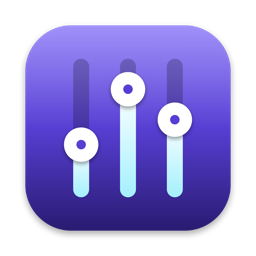

<p align="center">
  
</p>

<h1 align="center">Volume Mixer</h1>

<p align="center">
  Per-app volume control for macOS — like the Windows volume mixer.
</p>

---

In a Zoom call but want to keep watching YouTube? Volume Mixer lets you turn Zoom down to 20% while YouTube stays at full volume, or mute an app entirely. It lives in the menu bar and needs no kernel extension or virtual audio driver.

## Features

- **Per-app volume and mute** — every app that plays sound gets its own slider
- **Browser aware** — helper processes of Chrome, Edge, Safari, etc. are grouped under their app
- **Remembers your settings** — set Zoom to 30% once and it stays at 30% next meeting
- **System volume** and the current output device at the top
- **Sliders tinted with each app's color**, with a live equalizer indicator on apps that are playing
- **Launch at login**
- Follows output device changes (headphones ↔ speakers) automatically

## Requirements

- macOS **14.2** or later (the Core Audio process tap API was introduced in 14.2)
- Xcode or the Xcode Command Line Tools (`xcode-select --install`)

## Build & run

```sh
git clone https://github.com/ahmetselimergin/VolumeMixer.git
cd VolumeMixer
./build.sh
open "build/Volume Mixer.app"
```

Optionally drag `build/Volume Mixer.app` into your **Applications** folder.

The first time you turn an app down, macOS asks for permission to **access app audio** — click **Allow**. Audio is never recorded or stored; it is attenuated and sent straight back to your speakers.

## How it works

macOS has no built-in per-app volume. Volume Mixer uses the **Core Audio process tap** API added in macOS 14.2:

```
Zoom ──► Core Audio ──✕  (original output muted)
              │
              └──► Tap ──► Volume Mixer (× 30%) ──► Speakers
YouTube ──► Core Audio ───────────────────────────► Speakers
```

1. When an app is set below 100%, a muting tap is created for that app's processes.
2. The tap and the real output device are combined in a private aggregate device.
3. A real-time IOProc multiplies the tapped audio by the chosen gain (with a click-free ramp, no allocations) and writes it to the output.
4. Apps at 100% are left untouched — their audio takes the normal path.

### Compared to Windows

| | Windows | Volume Mixer |
|---|---|---|
| Mechanism | Audio engine applies a per-session gain while mixing | Captures, mutes and replays the app's audio at reduced gain |
| Added latency | None | A few milliseconds |
| Permission | None | "App audio access" |
| When the app quits | — | All apps return to 100% |

## Project layout

```
Sources/
  VolumeMixerApp.swift    Menu bar UI (SwiftUI)
  MixerModel.swift        App discovery, settings, tap lifecycle
  AppTap.swift            Process tap + aggregate device + real-time rendering
  CoreAudioHelpers.swift  Core Audio helpers, helper-process → app mapping
tools/make_icon.swift     Draws the app icon
build.sh                  Builds the .app bundle without an Xcode project
```

## Known limitations

- Volume can only be lowered (0–100%), not boosted.
- When an app starts playing, it can take up to ~1 second for its setting to apply.
- The app is ad-hoc signed, so macOS may ask for permission again after each rebuild.

## License

[MIT](LICENSE)
